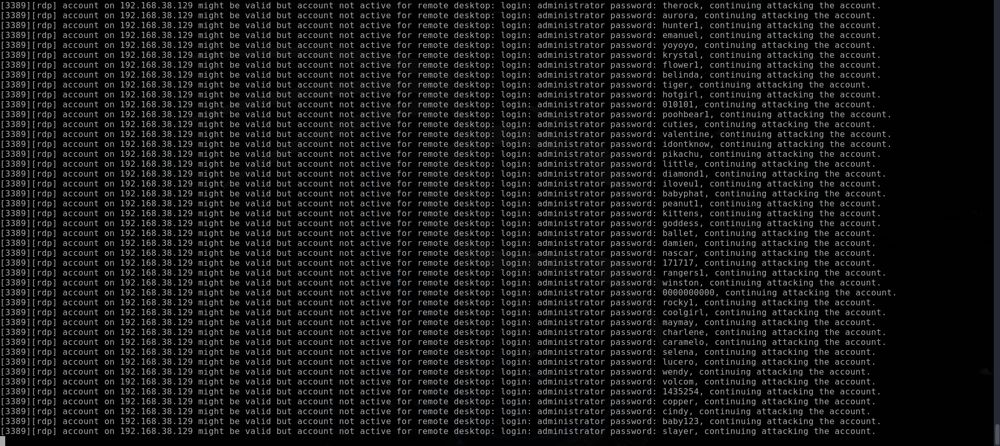
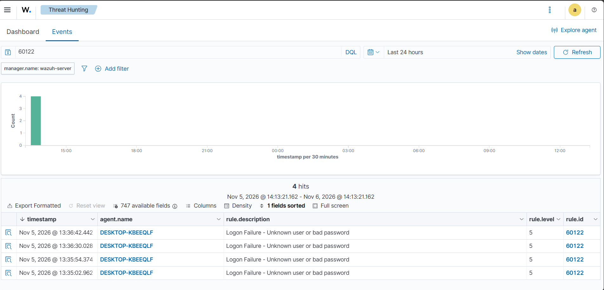
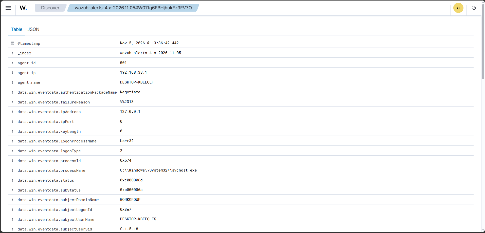

# Brute Force Attack Detection Investigation Report

## Executive Summary
This investigation analyzed simulated brute-force login attempts against a target Windows system. An automated password-guessing attack was launched using Hydra on Kali Linux. The authentication failure events were sent to the Wazuh SIEM server, which detected the suspicious traffic and triggered alert Rule 60122 ("Logon Failure").

---

## Technical Environment & Tools
* **Attacker Machine:** Kali Linux
* **Target Endpoint:** Windows Machine (`DESKTOP-KBEEQLF`)
* **Security Monitoring System:** Wazuh Server
* **Key Tools Used:** Hydra, Windows Event Viewer, Wazuh SIEM Dashboard

---

## Investigation Steps & Visual Evidence

### Task 1: Launch Brute Force Attack
* **Description:** Executed an automated password-guessing attack using Hydra against the target Windows host to generate logon failure events.
* **Evidence:**

---

### Task 2: Log Analysis & Alert Detection
* **Description:** Checked incoming security logs in the Wazuh dashboard. Wazuh flagged the high volume of failed logins under Rule 60122 (*Logon Failure - Unknown user or bad password*).
* **Evidence:**

---

### Task 3: Forensic Details & Source IP Identification
* **Description:** Inspected the JSON log details to identify the host and network IPs associated with the attack.
* **Key Telemetry Identified:**
  * **Agent IP (`agent.ip`):** `192.168.38.1` (Wazuh Agent interface IP)
  * **Target Host:** `DESKTOP-KBEEQLF`
  * **Local Event Source IP (`data.win.eventdata.ipAddress`):** `127.0.0.1` (Local loopback IP recorded by Windows authentication)
  * **Rule Triggered:** Rule `60122` (Level 5 Severity)
* **Evidence:**

---

## Skills Demonstrated
* **Threat Detection:** Analyzed SIEM alerts for repeated login failures.
* **Log Correlation:** Linked brute-force attack spikes to specific Wazuh rules.
* **Incident Investigation:** Examined event log fields to locate target host names and network IP details.
